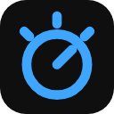
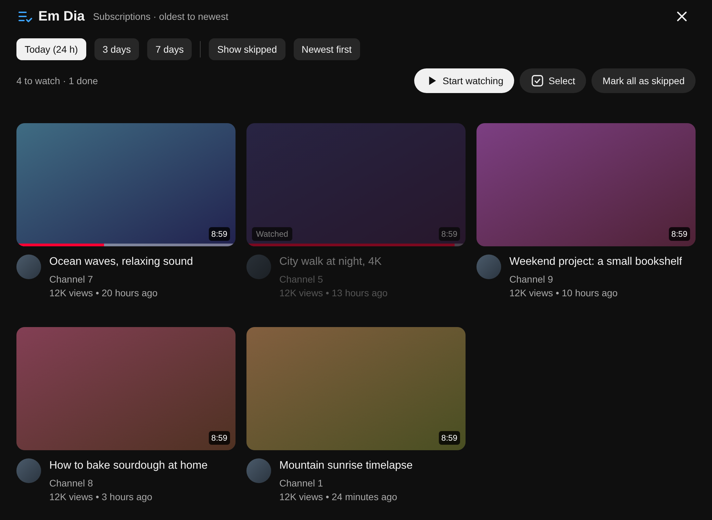
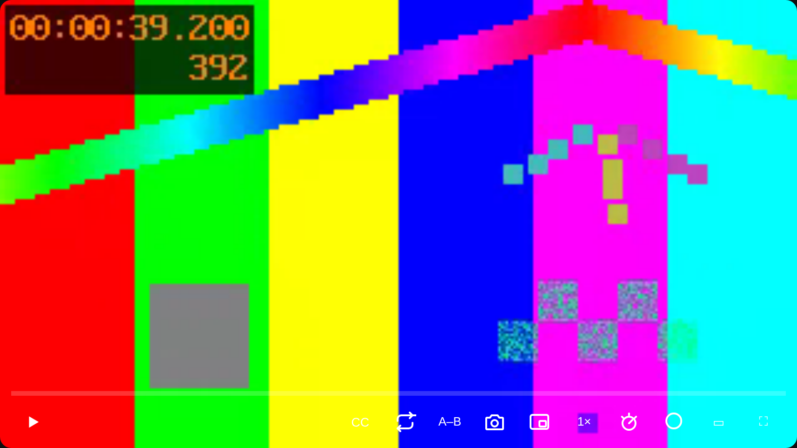
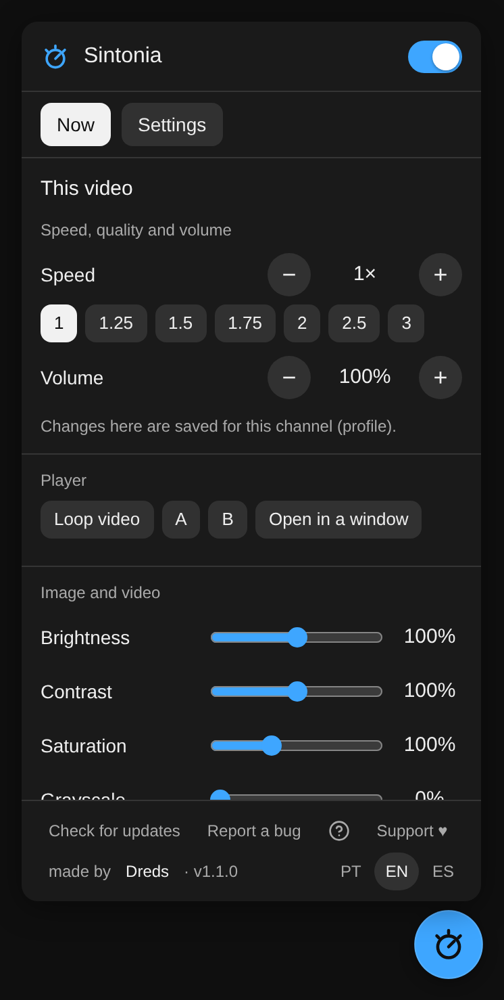
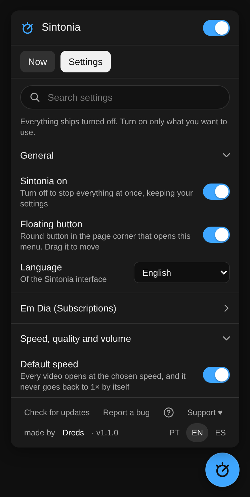

<div align="center">



# Sintonia

**YouTube, tuned once. Every channel remembers.**
Speed, quality, volume and more, saved per channel, plus **Em Dia**: a queue for your Subscriptions page. Free, no account, no server.


**Works on:** Chrome · Edge · Brave · Opera GX (desktop, youtube.com)



</div>

---

## What it does

Everything ships **turned off**. Switch on only what you want; there is one switch per feature, in a menu inside YouTube.

- **Remember per channel.** Speed, volume, quality, volume boost and skipped segments that you pick in the player are saved for *that channel* and applied the next time you open one of its videos.
- **Speed, quality and volume.** From 0.07× to 16×, and it never falls back to 1× by itself (not after an ad, not on the next video). Best quality up to a limit you set, 100% volume and unmuted on open, mouse wheel on the video for volume, Shift + wheel for speed, keyboard shortcuts (all with Alt, so they never clash with YouTube's), automatic theater mode and a cinema mode that dims the page around the player.
- **Em Dia (a queue for Subscriptions).** A button on the Subscriptions page opens a clean grid with the videos from **today, 3 or 7 days**, oldest first. Mark what you don't want to watch (**Not for me**; it is kept only in your browser, and the channel is *not* blocked), **Select** several at once, and press **Start watching** to play the rest in order with YouTube's own playlist (with a queue of its own as a fallback). Leave in the middle and *Continue (3/12)* picks it up again. Shorts, live streams, premieres and scheduled videos are left out unless you ask for them.
- **Auto like** *(off by default, and the one feature that **acts on your YouTube account**)*. Presses YouTube's own Like button for you: after part of the video is watched, on open, or only on channels you mark. It never touches a video that already has a like or a dislike, never removes a like, and skips ads and live streams.
- **"Subscribed" badge (off by default).** A small green **✓ Subscribed** tag next to the channel name on videos in **Home, related and search** when you already subscribe to that channel, and an option to **fade** those videos (they return to normal on hover; nothing is ever hidden). It reads your subscription list from YouTube (read-only) and keeps it only in your browser.
- **Hide distractions.** Comments, live chat, related videos, Shorts (everywhere), the end screen and cards, and a *Home goes to Subscriptions* option.
- **Audio.** Volume boost up to 400% for quiet videos, and an *even volume* option that brings quiet and loud videos closer.
- **Skip segments (SponsorBlock data).** Sponsors, self-promotion and subscribe reminders by default, plus the other SponsorBlock categories if you want them. **Read-only:** Sintonia never submits anything to SponsorBlock. A notice with **Undo** and colored marks on the progress bar.
- **Player extras.** Loop and A–B section, mini player when you scroll to the comments, open in its own window, reverse playlist, and no autoplay or download in background tabs. The player bar gets small buttons for them: a **1×** that changes the speed on click, Repeat, A–B, frame photo and window (each shows only when its feature is on).
- **Image and video.** Brightness, contrast, saturation, grayscale, invert and rotate for the open video, a dark theme, a **frame screenshot** (PNG named with the video and the time), and two options for slow PCs (avoid 60 fps, force H.264).
- **Comment order.** Picks *Newest first* or *Top* by itself when the comments load.
- **A menu inside YouTube.** A round button in the page corner (drag it anywhere) opens a menu with **Now** (the controls for what is on, split into *This video* and *This channel · profile*) and **Settings** (search, and one line of explanation under every item).

<div align="center">



&nbsp;&nbsp;

</div>

> These screenshots are made by this repository's test suite ([`tests/prints-github.mjs`](tests/prints-github.mjs)) on a **simulated YouTube page** with placeholder videos and channels: no account, no real video. Around Sintonia's own interface, the real site looks different.

## Install

Sintonia is not in a browser store: you install it from the release zip.

### Chrome, Edge, Brave and Opera GX

1. Download **`sintonia-vX.Y.Z.zip`** from the [latest release](https://github.com/DredsGG/sintonia/releases/latest) and unzip it into a folder you'll keep.
2. Open `chrome://extensions` (Edge: `edge://extensions`, Brave: `brave://extensions`, Opera GX: `opera://extensions`).
3. Turn on **Developer mode** and click **Load unpacked**. Pick the folder.
4. Open YouTube. A short tutorial opens on its own, and an install guide opens in a tab.

**Turn off Enhancer for YouTube** (or any other extension that sets speed and volume): two extensions fighting over the same player makes both misbehave. If you also run the official SponsorBlock extension, Sintonia steps aside from *Skip segments* and tells you once.

Opera GX: if the extension disappears after you close the browser, load it again (a known Opera issue with unpacked extensions).

### Updating

Sintonia checks this repository's releases by itself: when the browser opens, every 30 minutes, and whenever you come back to a YouTube tab. When there is a new version, a notice appears in the middle of the page with what changed and an **Update** button.

- *Update* downloads the new zip. Unzip it **over the same folder**; Sintonia notices within a minute and reloads itself, without reloading the video you are watching.
- The **✕** only postpones the notice for an hour. A release marked **URGENTE** (a fix for a serious problem) shows the notice without ✕, and Sintonia pauses until you update.

## Languages

Everything is in **Portuguese, English and Spanish**: the menu, Em Dia, notices, tutorial, *What's new*, update notice and the install guide. The first time, it follows your browser's language (any other language falls back to English). Switch any time with **PT · EN · ES** in the menu footer; the choice is saved.

## Privacy

Short version: **what you watch never leaves your browser.** There is no Sintonia server, no account, no analytics and no ads.

| | |
|---|---|
| **What it reads** (only on `youtube.com`) | The id, title and channel (id and name) of the video you are on, to find that channel's saved settings. On the Subscriptions page, the titles, channels, dates and watched bar of the videos in the grid, to build Em Dia. With the *Subscribed* badge on, your subscription list (the same read YouTube's *All subscriptions* page makes) and the channel of each video card on Home, related and search. The player's state (speed, volume, quality, time). None of this is sent anywhere. |
| **What it stores** (in your browser) | Small settings (the switches, language, a few numbers) in `storage.sync`, which your browser may sync through *your* Google or Microsoft account, if you have browser sync on. Everything else in `storage.local`: per-channel settings, Em Dia marks (skipped or watched, per video id, **deleted after 30 days**) and the queue position, the channels you marked for auto like and the ids already liked (30 days), a 6-hour cache of SponsorBlock answers, the last 30 technical events (**no URLs, titles or channel names**), the update state and the position of the round button, and, with the *Subscribed* badge on, your subscription list (channel ids and @handles, refreshed once a day; **never in `storage.sync`**). |
| **What it sends** | Only four kinds of requests. **1)** The update check: `GET api.github.com/repos/DredsGG/sintonia/releases/latest` (GitHub sees your IP, as with any request). **2)** *Skip segments*, **only if you turn it on**: `GET sponsor.ajay.app/api/skipSegments/<4 characters>`, where the 4 characters are the first 4 of the video id's SHA-256 hash, so SponsorBlock cannot tell which video you are watching; no cookies, read-only; the exact match is filtered inside your browser. **3)** Em Dia's thumbnails load from YouTube's own image server (`i.ytimg.com`), the same way YouTube's page loads them, and *Open in a window* opens a YouTube player page. **4)** With the *Subscribed* badge on: a read-only request to `youtube.com` itself (`/youtubei/v1/browse`, the one the *All subscriptions* page makes) with the authorization header the site itself uses; it never subscribes or unsubscribes and nothing goes to another server. Nothing else. |
| **What it does to your account** | Only **Auto like**, off by default (the *Subscribed* badge only reads): it clicks YouTube's own Like button with your session when you turn it on. Marks in Em Dia (*Not for me*) are never sent to YouTube. |
| **Report a bug** | Opens a new GitHub issue in your browser with a short diagnostic (version, browser, which switches are on). You read it before you send it. |
| **Permissions** | `storage` (your settings), `alarms` (update checks), `downloads` (the update zip and frame screenshots), `scripting` (to put a new version into tabs that are already open). Host access to `www.youtube.com`, `sponsor.ajay.app` and `api.github.com`. Nothing else. |

The code is here: read `extension/src/sw.js` (the only file that talks to the network) and `extension/manifest.json`.

## FAQ

**Why didn't it skip the sponsor?** *Skip segments* uses SponsorBlock's community database, and a **new video only skips after someone has marked its segments there**. While the video plays, Sintonia asks again every 5 minutes, and the menu says *Nobody has marked segments for this video yet* when that is the case. You can mark them yourself with the official SponsorBlock extension (Sintonia only reads, it never submits).

**Is the Auto like safe for my account?** It does exactly what your own click does, with your session, and it is off until you switch it on. Whether YouTube is fine with automated clicks is YouTube's call, not something this project can promise; use it at your own discretion.

**Why does Em Dia start a playlist?** It opens YouTube's own playlist with the videos you didn't skip (up to 50 per block). If YouTube doesn't create it, Sintonia keeps a queue of its own and turns autoplay off while it runs, so nothing from outside gets in.

**Does it work on mobile or Firefox?** No. Desktop Chrome, Edge, Brave and Opera GX only.

**Where do my settings go if I reinstall?** The small settings follow your browser sync if you have it on; the per-channel settings and Em Dia marks live in the browser profile and are lost if you remove the extension.

## How it works

- **Two worlds.** `src/main.js` runs in the page's own JavaScript world at `document_start` and is the only code that talks to YouTube's player API; it reports back with events. Everything else runs in the extension's isolated world and draws its interface in a shadow DOM, so YouTube's CSS can't leak in and clicks and keys inside it never reach the player.
- **Network only in the service worker** (`src/sw.js`): the update check, SponsorBlock and the downloads. The page scripts never call the network themselves.
- **No remote code.** No `eval`, no scripts loaded from a server; the update flow downloads a zip for *you* to unzip.
- **Per-channel settings** live in `storage.local` as `{ channel: { name, settings } }`; the player features write there when *Remember per channel* is on.
- **QR code** for the Support box: [qrcode-generator](https://github.com/kazuhikoarase/qrcode-generator) (MIT, Kazuhiko Arase), unchanged, in `extension/src/vendor/qrcode.js`. The Pix code is built locally in `src/apoio.js`.

## Tests

`tests/` loads Sintonia as a real unpacked extension in Chromium (Playwright 1.63.0) with a new temporary profile each run, on a **simulated YouTube** (`mock.mjs`, `mock-inscricoes.mjs`) that copies the DOM and the player API measured on the live site.

```
cd tests
npm i
node sintaxe-teste.mjs && node i18n-teste.mjs && node datas-teste.mjs
bash rodar.sh e2e-base e2e-emdia e2e-player e2e-like e2e-menu e2e-audio e2e-sb e2e-player2 e2e-imagem recarga-e2e
```

Each must end with `TUDO PASSOU`. `ao-vivo.mjs` runs against the real youtube.com (new profile, no login) and is for running by hand; `desempenho.mjs` measures CPU and memory over 10 minutes of real video. The **Test** workflow runs the first group on every push. See [`tests/README.md`](tests/README.md).

## Support

This project is free and always will be. If it helps you, you can support it on [GitHub Sponsors](https://github.com/sponsors/DredsGG) (one-time or monthly). 🇧🇷 In Brazil? Pix: `fa525dad-afca-4683-845d-eee7225a53e3`

## Disclaimer

Personal project, **not affiliated with or endorsed by YouTube or Google**. YouTube changes its pages often, so a feature can stop working until Sintonia is updated (use *Report a bug*). The feature ideas come from the YouTube extensions people already use; Sintonia was written from scratch, without copying code from any of them. Segment data for *Skip segments* comes from the [SponsorBlock](https://sponsor.ajay.app) community database, licensed [CC BY-NC-SA 4.0](https://wiki.sponsor.ajay.app/w/API_Docs), and is only read.

## License

[MIT](LICENSE) · third-party notices in [THIRD-PARTY-NOTICES.md](THIRD-PARTY-NOTICES.md) · made by [André Miller Fleck (Dreds)](https://github.com/DredsGG)
